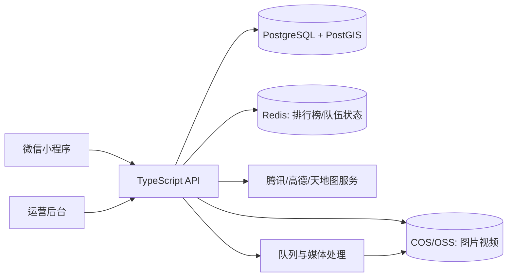

# 中国旅行登山点亮小程序：产品与技术设计

## 1. 产品定位

工作名：**行迹山河**。

这是一个以中国旅行为主的地图型社交小程序：用户记录去过的城市、景区和登过的山，地图按省、市、景区和山峰逐步点亮；每次行程可以附带照片、视频、轨迹和故事；用户可以组建 PACK，参加登山或旅行挑战，按有效打卡获得积分、勋章和排名。

核心循环：

```text
出发 → 定位/上传凭证 → 点亮地图 → 获得积分与勋章 → 加入 PACK/挑战 → 分享下一次行程
```

## 2. 首期范围

### 必做功能

- 微信登录、个人资料和隐私设置
- 中国省份、城市、景区、山峰地图
- 地点详情：海拔、难度、简介、图片、路线和用户故事
- 访问记录：日期、同行人、文字、照片、视频、轨迹
- 地图点亮：去过、登顶、计划去、重复访问四种状态
- PACK：创建队伍、邀请成员、队伍动态、队伍排行
- 挑战：官方挑战和用户创建的挑战
- 积分、勋章、排行榜、赛季结算
- 公开分享卡片和海报

### 第二期功能

- GPX 导入和路线回放
- 轨迹与地理围栏联合验证
- 离线缓存和弱网上传
- 活动报名、付费挑战和品牌赞助
- 俱乐部/领队后台
- 景区、文旅局或品牌的活动数据看板

## 3. 三个开源项目的分工

本项目不直接 Fork 三个项目的完整产品，而是按边界选择性复用。TRIP 可以作为旅行领域后端模型和 API 设计的参考或局部移植来源；100cims 和 MappedLove 继续以领域模型与交互参考为主。最终产品仍以中国地图、微信登录、小程序媒体能力和商业闭环为自研核心。

### TRIP：领域和行程参考

TRIP 根仓库是 MIT，可以商业二开。它的 FastAPI/SQLModel 后端已经覆盖 POI、行程、同行协作、附件、分享、GPX 和清单，适合局部复用或迁移模型；Angular 前端、SQLite、本地文件存储、用户名密码登录和 OSM/Photon 地图不直接作为生产方案。详细取舍见 [TRIP底座评估与选型结论.md](TRIP底座评估与选型结论.md)。

### 100cims：挑战玩法底座

参考山峰、区域挑战、难度积分、登顶记录、计划、聊天和排行榜。重点抽取 Challenge、Summit、Score、Ranking、Plan 等领域概念。复制代码前先确认根仓库的统一许可证，不能只依据子包的 MIT 标记。

### MappedLove：媒体和故事交互

参考地图标记、地点故事、相册、公开地图和共同编辑。照片/视频模型要扩展为原图、缩略图、转码视频、封面、经纬度、拍摄时间和可见范围。

## 4. 产品信息架构

### 小程序底部导航

1. **地图**：中国地图、点亮进度、附近山峰和景区
2. **挑战**：热门挑战、赛季、排行榜、PACK 挑战
3. **记录**：新建行程、上传照片/视频、导入轨迹
4. **动态**：PACK 动态、好友动态、公开故事
5. **我的**：点亮统计、勋章、收藏、隐私和设置

### 地图状态

- 灰色：未去过
- 浅色：计划去
- 绿色：到访过
- 金色：登顶过
- 紫色：完成挑战
- 动画光点：最近 30 天新增记录

地图首页要支持省份、城市、景区、山峰四级缩放，避免首次打开就加载所有用户媒体。

## 5. 关键数据模型

```text
User
 ├─ Visit ─ Place
 ├─ SummitRecord ─ Mountain
 ├─ Trip ─ Media
 ├─ ChallengeMembership ─ Challenge
 ├─ TeamMembership ─ Pack
 ├─ Badge / ScoreLedger
 └─ PrivacySetting
```

主要表：

- `place`：省、市、景区、山峰、坐标、海拔、难度、封面
- `visit`：用户、地点、日期、状态、经纬度、验证状态、可见范围
- `trip`：行程、起止时间、同行 PACK、路线摘要
- `media`：照片/视频、对象存储地址、缩略图、封面、EXIF、审核状态
- `mountain`：山峰、路线、海拔、难度、官方坐标、路线 GPX
- `challenge`：规则、时间、地点范围、积分系数、排名方式
- `challenge_checkin`：挑战、用户/队伍、打卡、得分、审核状态
- `pack`：队伍、成员、队长、邀请码、公开状态
- `score_ledger`：积分来源、积分值、赛季、可追溯的业务单号
- `badge` / `user_badge`：勋章定义和获得记录

数据库采用 PostgreSQL + PostGIS，地点、山峰、轨迹和地理围栏都使用空间字段。

## 6. 打卡和防作弊

首期采用“自动判断 + 风险标记 + 管理员复核”：

- GPS 进入地点或山峰地理围栏；
- 记录时间和设备定位精度；
- 上传照片时读取 EXIF，但不把 EXIF 作为唯一凭证；
- 同一用户短时间跨越不合理距离时标记风险；
- 挑战积分采用待结算状态，异常记录不立即进入最终榜单；
- 高价值挑战支持领队或管理员人工审核；
- 用户可以隐藏精确位置，只展示景区或城市级位置。

不要把“上传一张照片”直接等同于有效登顶。排行榜必须基于可追溯的 `score_ledger`，方便申诉和撤销。

## 7. 技术架构



推荐技术组合：

- 小程序：原生 TypeScript，后续可用 Taro/uni-app 扩展多端；
- API：NestJS 或 Fastify + TypeScript；
- 数据库：PostgreSQL + PostGIS；
- 缓存：Redis；
- 媒体：腾讯云 COS 或阿里云 OSS，异步生成缩略图和视频封面；
- 队列：BullMQ；
- 管理后台：React 或 Vue；
- 部署：Docker、Nginx、对象存储和 CDN。

开源项目的 Web 地图层不要直接搬到小程序。中国版本使用微信 `map` 组件和国内地图服务；需要明确处理 WGS84、GCJ-02 等坐标体系，不能把海外 OSM 瓦片直接作为生产地图。

## 8. 商业闭环

### 用户侧

- 免费：基础点亮、基础相册、公开挑战；
- 会员：高清/大容量媒体、完整轨迹、进阶统计、专属勋章；
- 付费活动：官方登山挑战、路线活动、线下集合；
- PACK 增值：队伍空间、共享相册、队伍徽章、长期数据保存。

### B 端

- 景区和文旅局：区域点亮活动、游客挑战、数据看板；
- 户外品牌：品牌挑战、装备任务、勋章和优惠券；
- 领队/俱乐部：活动发布、报名、签到和队伍管理。

积分不能直接兑换现金，先作为等级、勋章和活动资格使用，降低刷分和合规风险。

## 9. 迭代顺序

### Milestone 1：地图和记录

登录、地点库、地图点亮、访问记录、照片上传、个人统计。

### Milestone 2：山峰和挑战

山峰库、难度积分、挑战规则、排行榜、勋章、赛季。

### Milestone 3：PACK 和媒体

队伍、邀请、动态、共享相册、视频转码、公开分享卡片。

### Milestone 4：商业化

活动报名、会员、品牌挑战、运营后台、审核和数据报表。

## 10. 二开与许可证策略

- 推荐保留 PostgreSQL/PostGIS 的自研基础设施，按模块吸收 TRIP 的地点、行程、协作、分享和媒体领域模型；不直接 Fork TRIP 的 Angular 前端和 SQLite 部署方案；
- 100cims 根仓库没有统一许可证，先参考挑战领域和交互，不复制 API 或整套 App；
- MappedLove 主仓库是 MIT，但依赖和服务条款较多，只按需复制明确 MIT 的独立代码，并保留第三方声明；
- 不建议直接把 TREK/AdventureLog 的 GPL/AGPL 代码混入商业闭源核心；
- 保留所有原项目版权声明、NOTICE 和第三方依赖许可证；
- 上线前让法务核对地图数据、定位服务、媒体内容和开源许可证。

最终推荐：**自研业务底座，100cims 提供挑战领域设计，MappedLove 提供媒体和故事交互，微信小程序端和中国地图服务全部自主实现。**

## 11. 当前实现进度

- M1 已完成：开发用户上下文、TRIP 风格行程/行程日/行程项目、媒体资产登记和首页行程展示；
- M2 已完成服务端骨架：地点围栏验证、风险标记、挑战打卡、积分账本、勋章、赛季排行榜、GPX 轨迹登记和管理员复核；
- M3 已完成服务端骨架：PACK、邀请码、成员权限、队伍任务、共享相册、动态、评论和点赞；
- M2/M3 仍需生产化：微信定位授权、真实地图 SDK、GPX 文件解析 Worker、对象存储直传、Redis 排行榜缓存、内容审核和运营后台。

## M4 当前实现进度（2026-10-18）

M4 已完成可运行开发闭环：活动列表和报名、mock 支付、退款、优惠券、会员订阅、活动签到、品牌挑战赞助绑定和运营统计。所有支付接口按开发/生产模式分离，未配置微信商户参数时不会伪造支付结果。下一阶段是生产微信支付适配、商家后台、媒体额度计费和审计报表。
