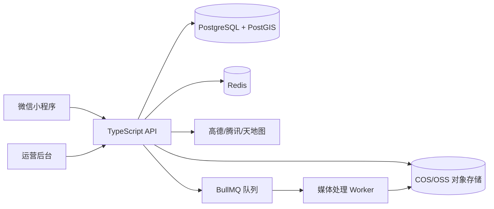

# 行迹山河：选择性复用 TRIP 的实施设计

## 1. 目标和边界

本设计把 TRIP 当作旅行领域的成熟参考和局部代码来源，把当前 `xingji-shanhe` 的 PostgreSQL/PostGIS + Docker 作为基础设施。产品核心仍然是中国旅行、登山点亮、PACK、挑战和商业闭环。

不直接使用 TRIP 的 Angular 页面、SQLite 文件库、本地媒体目录、用户名密码登录和海外地图服务。

## 2. 最终架构



### 运行时分工

| 组件 | 首期职责 | 来源/策略 |
|---|---|---|
| 小程序 | 地图点亮、记录、媒体、挑战、PACK、动态 | 自研原生 TypeScript 页面 |
| API | 用户、地点、行程、媒体、挑战、队伍、积分 | 当前 Node.js API 逐步模块化 |
| PostgreSQL/PostGIS | 业务数据、空间查询、地理围栏、轨迹摘要 | 延续当前 Docker 数据库 |
| Redis | 排行榜缓存、幂等锁、上传任务状态、限流 | 第二阶段加入 |
| COS/OSS | 原图、缩略图、视频、封面、GPX | 第二阶段加入，开发环境可先用本地 MinIO |
| Worker | 图片缩略图、视频转码、EXIF、审核回调 | BullMQ + FFmpeg/sharp |
| 运营后台 | 地点库、挑战、审核、赛季、商业活动 | 独立 Web 管理端 |

## 3. TRIP 模型到本项目的映射

| TRIP | 行迹山河 | 处理方式 |
|---|---|---|
| `Place` | `place`、`mountain`、`scenic_spot`、`city` | 保留名称、坐标、描述、图片、访问状态；增加层级、海拔、难度、围栏 |
| `Trip` | `trip` | 增加起止时间、PACK、公开范围和轨迹摘要 |
| `TripDay` | `trip_day` | 直接吸收日期、标题、备注和排序关系 |
| `TripItem` | `trip_item` | 增加地点引用、故事文本、媒体和轨迹片段 |
| `TripMember` | `pack_member` | 从行程协作者扩展为 PACK 角色、队长、退出和封禁 |
| `TripShare` | `share_token` | 保留令牌分享思路，增加过期时间和隐私范围 |
| `Image`/`TripAttachment` | `media_asset` | 扩展照片、视频、封面、转码、审核和对象存储 |
| packing/checklist | `pack_list`、`pack_task` | 作为出发准备和队伍任务，不作为核心挑战规则 |
| GPX | `track`、`track_point_summary` | 保留导入思路；轨迹点进入空间字段并异步抽样 |
| provider | `map_provider` | 只保留抽象接口，生产替换为国内地图服务 |

## 4. 核心数据模型

### 4.1 地点和点亮

```text
place
  id, type(city/scenic/mountain), name, parent_id
  province_code, city_code, latitude, longitude, geom(Point)
  geofence(Polygon), elevation, difficulty, cover_media_id
  source, status, created_at, updated_at

visit
  id, user_id, place_id, trip_id, visit_type
  visited_at, location_geom, accuracy_m
  verification_status, visibility, risk_level, note

summit_record
  id, user_id, mountain_id, visit_id, summit_time
  evidence_status, reviewer_id, reviewed_at
```

`visit_type` 使用 `planned`、`visited`、`summit`；`verification_status` 使用 `pending`、`verified`、`rejected`、`manual_review`。地图点亮由已验证访问记录聚合，不能直接由客户端传入结果。

### 4.2 行程、PACK 和媒体

```text
trip
  id, owner_id, name, start_at, end_at, visibility
  pack_id, cover_media_id, notes, status

trip_day
  id, trip_id, day_date, title, notes, sort_order

trip_item
  id, trip_day_id, place_id, title, story, lat, lng
  start_at, end_at, sort_order

pack
  id, owner_id, name, invite_code, visibility, status

pack_member
  pack_id, user_id, role(owner/admin/member), status, joined_at

media_asset
  id, owner_id, trip_id, visit_id, kind(photo/video/cover/gpx)
  object_key, thumbnail_key, poster_key, duration_ms, width, height
  exif_json, visibility, moderation_status, processing_status
```

媒体记录只保存对象存储键和可公开的元数据，访问地址由 API 按权限生成，避免把永久 COS/OSS 地址写入动态和排行榜。

### 4.3 挑战、积分和排行榜

```text
challenge
  id, name, season_id, rule_json, scope_json
  start_at, end_at, status, sponsor_id

challenge_member
  challenge_id, subject_type(user/pack), subject_id, joined_at

challenge_checkin
  id, challenge_id, subject_type, subject_id, visit_id
  rule_version, base_score, bonus_score, status, reviewed_at

score_ledger
  id, season_id, user_id, pack_id, source_type, source_id
  delta, status, idempotency_key, created_at

leaderboard_snapshot
  season_id, scope, subject_id, score, rank, calculated_at
```

积分必须通过 `score_ledger` 产生，使用唯一 `idempotency_key` 防止重复记分。排行榜读取 Redis，结算结果落库，方便撤销和申诉。

## 5. API 设计

API 采用 `/api/v1` 前缀，所有需要用户身份的接口通过微信登录后的短期 access token 调用。

### 第一批接口

```text
POST   /api/v1/auth/wechat-login
GET    /api/v1/me

GET    /api/v1/places?level=province|city|scenic|mountain&bbox=...
GET    /api/v1/places/:id
POST   /api/v1/visits
GET    /api/v1/me/map-summary

POST   /api/v1/trips
GET    /api/v1/trips
GET    /api/v1/trips/:id
POST   /api/v1/trips/:id/days
POST   /api/v1/trips/:id/items

POST   /api/v1/media/presign
POST   /api/v1/media/:id/complete
GET    /api/v1/media/:id/url

POST   /api/v1/packs
POST   /api/v1/packs/:id/invitations
GET    /api/v1/packs/:id/members

GET    /api/v1/challenges
POST   /api/v1/challenges/:id/join
GET    /api/v1/challenges/:id/progress
GET    /api/v1/leaderboards/:season
```

TRIP 的 `Place/Trip/TripDay/TripItem/TripMember/TripShare` API 可以作为字段和权限设计参考，但不要直接暴露其用户名字段和 SQLite 假设。

## 6. 关键业务流程

### 6.1 微信登录

1. 小程序拿到 `code`；
2. API 调用微信 `code2Session`；
3. 以 `openid` 绑定 `user_identity`，首次登录创建用户；
4. 返回短期 access token 和 refresh token；
5. 不把 openid 返回给前端展示，也不把 unionid 当作公开昵称。

### 6.2 记录一次访问

1. 客户端提交地点、时间、定位精度和可见范围；
2. API 查询地点围栏，计算距离和风险；
3. 创建 `visit=pending`；
4. 媒体上传完成后异步读取 EXIF 和审核状态；
5. 自动规则通过则进入 `verified`，否则进入 `manual_review`；
6. 事务性写入 `score_ledger`，再刷新点亮和挑战进度。

### 6.3 媒体上传

1. API 校验文件类型、大小、用户配额和业务归属；
2. 返回一次性预签名上传地址；
3. 客户端直传 COS/OSS；
4. 客户端调用 `complete`，Worker 生成缩略图/视频封面并做内容审核；
5. 只有 `processing_status=ready` 且审核通过的媒体才进入公开动态。

## 7. 小程序页面

```text
pages/map/index             中国地图和点亮进度
pages/place/detail          城市/景区/山峰详情
pages/visit/create          访问记录和凭证
pages/trip/detail           行程、故事、媒体和轨迹
pages/challenge/index       挑战列表和赛季
pages/challenge/detail      规则、进度、排名
pages/pack/detail           PACK 成员、任务和动态
pages/feed/index            公开故事和队伍动态
pages/profile/index         点亮统计、勋章和设置
```

地图首页只返回当前视口和聚合点，地点详情再加载媒体，避免首次打开请求全部照片和视频。

## 8. Docker 演进

### 当前开发环境

保留现有 `app + postgis` 两个服务，继续使用演示数据。

### Milestone 1

增加：

- `redis`：排行榜和任务状态；
- `minio`：本地对象存储模拟；
- `worker`：媒体任务和挑战结算。

### 生产环境

```text
nginx / 微信合法域名
  ├─ api container x 2
  ├─ worker container x 2
  ├─ PostgreSQL + PostGIS
  └─ Redis
        └─ COS/OSS + CDN
```

数据库迁移使用版本化 SQL 或 Prisma migration。不得把 TRIP 的 SQLite 文件直接挂载到生产环境。

## 9. 实施顺序

### M1：把 MVP 变成真实用户产品

- `demo-user` 替换为微信用户和 token；
- 地点、访问记录、点亮聚合改成用户维度；
- 增加 `trip`、`trip_day`、`trip_item`；
- 增加 COS/OSS 预签名照片上传。

### M2：挑战和山峰

- 山峰库、地理围栏、GPX；
- Challenge、Checkin、ScoreLedger；
- 勋章和赛季排行榜；
- 风险记录和管理员复核。

### M3：PACK 和媒体社交

- PACK 成员、邀请、角色和共享相册；
- 动态、评论、点赞和公开分享；
- 视频转码、封面和内容审核。

### M4：商业闭环

- 付费活动、微信支付、退款和对账；
- 品牌挑战、景区活动和优惠券；
- 会员配额、运营后台和数据报表。

## 10. 验收标准

- 用户可以通过微信登录并只看到自己的访问记录；
- 地图点亮由服务端验证记录生成；
- 一次行程可以包含多个日期、地点、故事和媒体；
- PACK 成员权限可追踪，退出后不能继续访问私有媒体；
- 重复提交同一打卡不会重复记分；
- 排行榜可按用户和 PACK 查询，并能撤销异常积分；
- 媒体不经过审核不会出现在公开动态；
- Docker 重启后数据库、任务状态和媒体记录可恢复；
- 发布包包含 TRIP MIT 声明及所有依赖的 NOTICE/许可证清单。

## 11. M3 已实现的 PACK 与媒体社交骨架

- `packs`、`pack_members`、`pack_invitations`：支持队伍创建、邀请码加入、成员角色和退出；
- `pack_tasks`：支持队伍任务和成员指派；
- `feed_posts`、`feed_post_media`、`feed_comments`、`feed_likes`：支持队伍动态、共享媒体、评论和点赞；
- 行程和媒体资产可以绑定 `pack_id`，PACK 详情可以读取共享相册；
- 所有 PACK 和动态接口都在服务端校验成员权限，动态按 private/pack/public 过滤；
- 首页已经显示 PACK 动态和赛季榜单，当前 Docker 环境用 `demo-pack-2026` 作为演示队伍。

生产化还需要接入对象存储直传、媒体审核、通知推送、举报处理和 Redis 缓存。


## M4 当前实现进度（2026-10-18）

已在 `xingji-shanhe` 原型中接入商业闭环骨架：付费活动与容量、订单状态、mock 支付幂等事件、退款、优惠券领取与核销、会员计划和订阅、活动签到、品牌挑战赞助字段，以及管理员订单/活动/收入统计接口。开发环境使用 `PAYMENT_MODE=mock`，微信支付接口在缺少商户参数时明确返回 501，不伪造真实支付。生产化仍需接入微信支付 SDK、回调验签、退款和对账下载，并补充对象存储、媒体额度实际扣减和独立运营后台。
